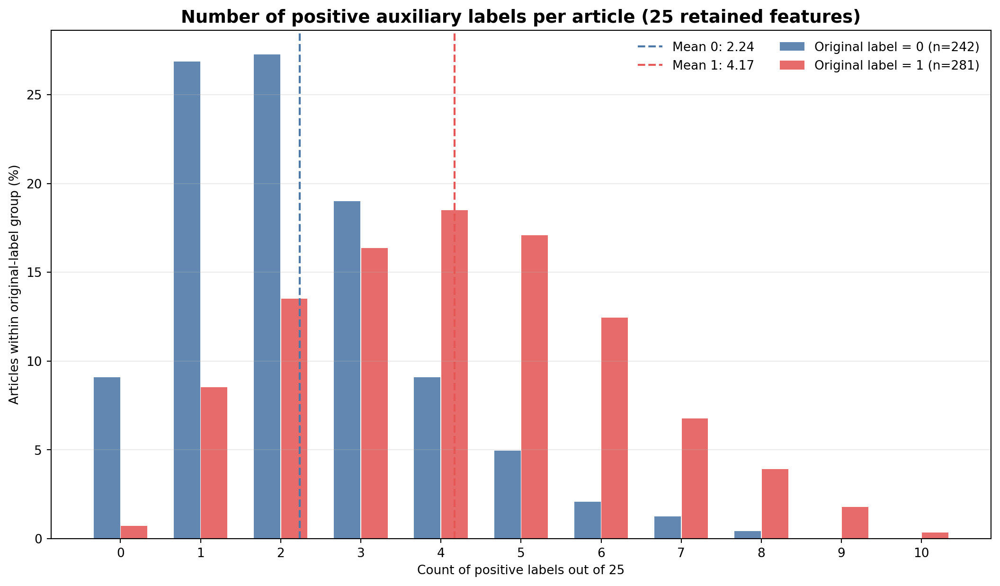
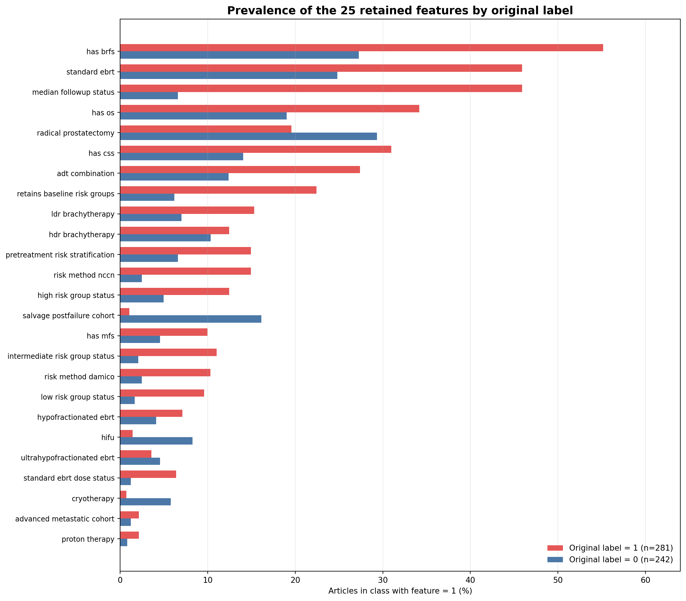

# Auxiliary Labeling Method: 25 Retained Features (Revised from 26)

## Objective and Output

This stage adds binary auxiliary features related to PCRSG criteria to articles with abstracts. The original 15 columns are retained with their original names, order, and values. The final file is `labeled-dataset-v2-aux25.csv`, with 523 article rows, 15 source columns, and 25 retained binary feature columns. The original input file was not modified.

The candidate vector initially contained 26 features. After checking the label distribution, `postop_pathology_exclusion` was removed from the final vector because it was 0 for all 523 records. A feature with no positive examples has zero variance and supplies no discriminative training signal in this dataset. Its all-zero pattern may also reflect that the abstract-based rule was too narrow or that abstracts did not report the information; it should not be interpreted as proof that the concept never occurs in the full articles. The feature can be reconsidered after revising its definition or obtaining additional evidence.

The `risk_method_zelefsky` feature is also omitted because no abstract in this dataset explicitly mentioned Zelefsky.

## Input and Excluded Record

The source file contains 524 records. One record with a blank abstract was excluded: PMID `21056265`, whose original label is `0`. The final output contains 523 articles. All 15 source columns and their values were preserved for retained rows.

## Meaning of 0 and 1

- `1`: The abstract contains explicit evidence that meets the definition for the feature.
- `0`: No sufficient explicit evidence for `1` was found in the abstract. This may mean the information was not reported in the abstract; it does not establish that the feature is absent from the full article.
- Titles, author names, the original article label, and assumptions about full-text content were not used to assign these labels. Counts, thresholds, and terminology were used only when explicitly stated in the abstract.
- Binary values were generated through rule-based extraction from abstract text. This is a reproducible first-pass dataset for research review, not a substitute for manual expert adjudication of ambiguous cases.

## Retained Feature Definitions

| Feature | Evidence required for a value of 1 |
|---|---|
| `risk_method_damico` | The name D’Amico appears in the abstract. |
| `risk_method_nccn` | The name or abbreviation NCCN appears in the abstract. |
| `pretreatment_risk_stratification` | Pretreatment risk classification is explicit, or baseline risk groups are separately followed in the results. |
| `low_risk_group_status` | The explicitly reported low-risk group contains at least 100 patients; 0 if no independent group count is available. |
| `intermediate_risk_group_status` | The explicitly reported intermediate-risk group contains at least 100 patients; 0 if no independent group count is available. |
| `high_risk_group_status` | The explicitly reported high-risk group contains at least 50 patients; 0 if no independent group count is available. |
| `retains_baseline_risk_groups` | Outcomes are reported by at least two baseline risk groups. |
| `radical_prostatectomy` | Radical prostatectomy is a study intervention or treatment; history of surgery alone is insufficient. |
| `standard_ebrt` | EBRT is used in the study and the abstract does not specify a hypofractionated or SBRT-only regimen. |
| `hypofractionated_ebrt` | Hypofractionated EBRT is explicitly stated in the methods or intervention. |
| `ultrahypofractionated_ebrt` | Ultrahypofractionation, SBRT, or stereotactic body radiation is explicitly stated. |
| `proton_therapy` | Proton therapy is a study intervention. |
| `ldr_brachytherapy` | LDR brachytherapy or a compatible seed/isotope, such as I-125, is explicitly used as treatment. |
| `hdr_brachytherapy` | HDR brachytherapy is explicitly stated in the methods or intervention. |
| `adt_combination` | ADT/hormone therapy is reported with a study local treatment in the methods or intervention; an explicit ADT-plus-RT regimen is sufficient evidence. |
| `cryotherapy` | Cryotherapy/cryoablation is a study treatment. |
| `hifu` | HIFU is a study treatment. |
| `has_brfs` | Biochemical recurrence/failure-free survival, biochemical control, freedom from biochemical failure, or PSA progression-free survival is explicitly stated as an outcome; a mention of biochemical recurrence alone is insufficient. |
| `has_os` | Overall survival is reported or assessed as an outcome. |
| `has_mfs` | Metastasis-free or distant metastasis-free survival is reported or assessed; mention of metastasis alone is insufficient. |
| `has_css` | Cancer-specific, cause-specific, or disease-specific survival is reported or assessed. |
| `standard_ebrt_dose_status` | An explicit dose for non-hypofractionated EBRT is at least 72 Gy; mixed, lower, or unreported doses are coded 0. |
| `median_followup_status` | Explicit median follow-up is at least 60 months. |
| `advanced_metastatic_cohort` | The study’s primary population is explicitly advanced/locally advanced or metastatic; mention of metastasis as an outcome is insufficient. |
| `salvage_postfailure_cohort` | Salvage treatment after recurrence, failure, or progression of prior treatment is explicitly studied. |

## Important Thresholds and Limitations

- Minimum group sizes: 100 patients for low risk, 100 for intermediate risk, and 50 for high risk. The total study population was not substituted for a group-specific count. If an independent group count was unclear in the abstract, the value was coded 0.
- EBRT dose: the 72 Gy threshold applies only to explicitly reported non-hypofractionated EBRT. An unreported dose, a mix of doses below and above the threshold, or a dose that cannot be explicitly attributed to EBRT was coded 0.
- Follow-up: only an explicitly stated median follow-up was converted; 60 months or longer is coded 1. Study duration or follow-up without an explicit median was not substituted.
- Treatment modalities were coded positive only when the methods, intervention, or corresponding abstract text indicated that they were study treatments. A mention in the introduction or as patient history was insufficient.
- Because the output is binary, both lack of evidence and lack of reporting map to 0. For final multitask training, unreported cases should ideally be reviewed separately or masked for the relevant task.

## Descriptive Charts

The figures below summarize the 25 retained features. Percentages in the first chart are calculated within each original-label group; the second chart compares feature prevalence by original label.

## Number of Positive Labels

These counts represent abstracts for which rule-based extraction found positive evidence; they are not an independent assessment of label quality.

| Feature | Positive count out of 523 |
|---|---:|
| `risk_method_damico` | 35 |
| `risk_method_nccn` | 48 |
| `pretreatment_risk_stratification` | 58 |
| `low_risk_group_status` | 31 |
| `intermediate_risk_group_status` | 36 |
| `high_risk_group_status` | 47 |
| `retains_baseline_risk_groups` | 78 |
| `radical_prostatectomy` | 126 |
| `standard_ebrt` | 189 |
| `hypofractionated_ebrt` | 30 |
| `ultrahypofractionated_ebrt` | 21 |
| `proton_therapy` | 8 |
| `ldr_brachytherapy` | 60 |
| `hdr_brachytherapy` | 60 |
| `adt_combination` | 107 |
| `cryotherapy` | 16 |
| `hifu` | 24 |
| `has_brfs` | 221 |
| `has_os` | 142 |
| `has_mfs` | 39 |
| `has_css` | 121 |
| `standard_ebrt_dose_status` | 21 |
| `median_followup_status` | 145 |
| `advanced_metastatic_cohort` | 9 |
| `salvage_postfailure_cohort` | 42 |
